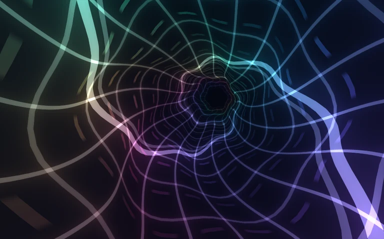

# Aurora Tunnel



## Run the example

The example needs Vulkan support in SDL3 and a Vulkan driver. It includes compiled shaders. It does
not need any SDL add-ons or a shader compiler.

From the repository root, run:

```sh
dune exec --profile release ./examples/aurora_tunnel/aurora_tunnel.exe
```

Move the mouse to steer. Press the left mouse button to send a pulse through the tunnel. Press
`Space` to pause or resume. Press `Esc` or close the window to exit.

## How it draws

The GPU uses one ring mesh to draw the tunnel. A mesh describes points and the triangles that join
them.  The vertex shader bends 96 copies of the ring into place. The fragment shader lights the
walls and reads colors from a texture that the OCaml code makes.

The [OCaml code](aurora_tunnel.ml) uploads the mesh and color texture in one copy pass. It waits on
a fence, which signals when the GPU finishes the upload. For each frame, the code sends the time,
view, and pulse depth to both shaders. It draws all the rings with one indexed draw. An indexed draw
uses a list of vertex numbers to reuse points across triangles.

## Run a short test

Run three frames from the repository root:

```sh
dune build --force @runtest-aurora
```

If your system supports offscreen Vulkan, run the test without a display:

```sh
SDL_VIDEO_DRIVER=offscreen dune build --force @runtest-aurora
```

## Rebuild the shaders

The `.spv` files contain the compiled shaders. If you edit a shader, use `glslangValidator` to
rebuild the `.spv` file and `spirv-val` to test it. Run these commands from the repository root:

```sh
for shader in examples/aurora_tunnel/shaders/tunnel.vert examples/aurora_tunnel/shaders/tunnel.frag; do
  glslangValidator -V --target-env vulkan1.0 -g0 "$shader" -o "$shader.spv" || exit 1
  spirv-val --target-env vulkan1.0 "$shader.spv" || exit 1
done
```
