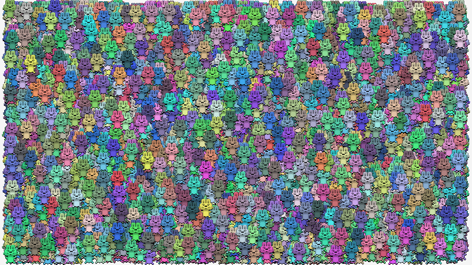

# Bunnymark



Bunnymark moves and draws many copies of one bunny image. It measures how many frames the
renderer draws per second. This OCaml example is based on
[Raylib's Bunnymark](https://www.raylib.com/examples/textures/loader.html?name=textures_bunnymark).

## Run the example

Install SDL3_image with PNG support. From the repository root, run:

```sh
dune exec --profile release ./examples/bunnymark/bunnymark.exe
```

Hold the left mouse button to add 100 bunnies per frame, up to 80,000. Press `P` to pause or resume
movement. Press `Esc` or close the window to exit. The window title shows the bunny count and the
frame rate.

## Measure a fixed workload

Use `--bunnies` to set the initial bunny count and `--frames` to set the number of frames. From the
repository root, run:

```sh
dune exec --profile release ./examples/bunnymark/bunnymark.exe -- --bunnies 10000 --frames 300
```

The example prints its average frame rate when it exits. It does not wait for the display to refresh
between frames.

## How it draws

The [example](bunnymark.ml) creates one [`Sprite_batch`](../../docs/rendering.md#draw-from-a-texture-atlas)
and adds each bunny once. The batch stores the image region and tint for each bunny. Each frame,
the example updates the positions in place and draws the same batch. It stores speeds separately
and does not create new rectangles or colors for existing bunnies.

The [port](bunnymark.LICENSE) and the [bunny image](assets/LICENSE.md) keep their original licenses.
