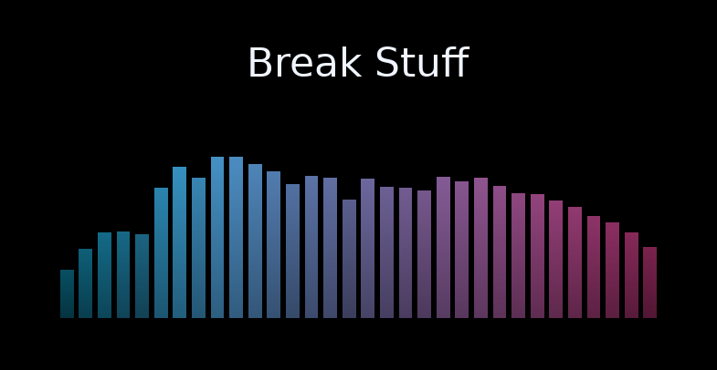

# Music Player



Music Player starts with a black, resizable window. Drop music files onto it to start a new
playlist.  The player skips files that SDL_mixer cannot open. It stops after the last track without
repeating.

The spectrum shows the strength of the sound from bass on the left to treble on the right. The
player shows the current track's title if SDL_mixer reports one. Otherwise, it shows the file name.

## Run the player

Build with SDL3, SDL3_mixer, and SDL3_ttf. The player also needs a Vulkan driver and the `fftw3`
opam package. FFTW is only a dependency of this example. The player includes its font and compiled
shaders, which are programs that run on the GPU.

From the repository root, run:

```sh
opam install fftw3
dune exec --profile release ./examples/music_player/music_player.exe
```

To start with files already in the playlist, pass their paths after `--`:

```sh
dune exec --profile release ./examples/music_player/music_player.exe -- track1.wav track2.flac
```

The available music formats depend on your SDL_mixer build.

| Key | Action |
| --- | --- |
| F | Enter or leave fullscreen. |
| Q | Quit. |
| Space | Pause or resume. At the end of the playlist, replay the last track. |
| P | Play the previous track, or restart the first track. |
| N | Play the next track, if there is one. |

## Build a standalone Linux bundle

Use this option to run the player on another Linux x86-64 machine without OCaml, opam, or Dune.  Use
the same build dependencies as in [Run the player](#run-the-player). From the repository root, run:

```sh
bash examples/music_player/bundle-linux.sh
```

The script builds the player in the release profile. The archive includes the executable, font,
compiled shaders, SDL libraries, and FFTW. The script also includes common audio decoders that it
finds on the build machine.

Copy `_build/music-player-linux-x86_64.tar.gz` to the target machine. On that machine, run:

```sh
tar -xzf music-player-linux-x86_64.tar.gz
./music-player-linux-x86_64/run
```

Keep the extracted files together. The target still needs a compatible glibc (the Linux C library)
and working display, audio, and Vulkan drivers. Build and test on the oldest Linux distribution you
plan to support. Before you distribute the bundle, make sure that you meet the licenses for its
libraries, including FFTW.

## How it works

The offline mixer produces stereo audio at 48 kHz without opening a playback device. The player
queues these samples to an SDL audio stream and sends the same samples to the analyzer. It keeps
about 64 ms of audio queued. All application code runs on the main thread.

The analyzer takes 4,096 samples from each channel and applies a Hann window, which fades the
samples at the ends. The fast Fourier transform (FFT) measures the frequencies in that window.  The
next window starts 2,048 samples later, so the windows overlap by half. The analyzer adds power from
both channels into 32 logarithmic bands from 20 Hz to 20 kHz. A logarithmic scale gives each band
the same ratio between its upper and lower frequencies.

The player reuses one FFTW plan, which defines how to compute the transform. It also reuses the
buffers for samples and results. The display maps power from −72 to 0 dBFS, or decibels relative to
full scale, to bar heights. It targets 60 frames per second. SDL_ttf draws the title to a surface in
memory. The player uploads that image when the title changes and draws it with the bars in one GPU
call.

## Run the tests

`dune runtest examples/music_player` tests the spectrum and the playlist with a dummy audio driver.
If your system supports offscreen Vulkan, run the player without a display or speakers:

```sh
SDL_VIDEO_DRIVER=offscreen SDL_GPU_DRIVER=vulkan dune build --force @runtest-music-player
```

This starts the empty player, then starts it with a generated tone. To limit either run yourself,
pass `--frames COUNT` to the player.
